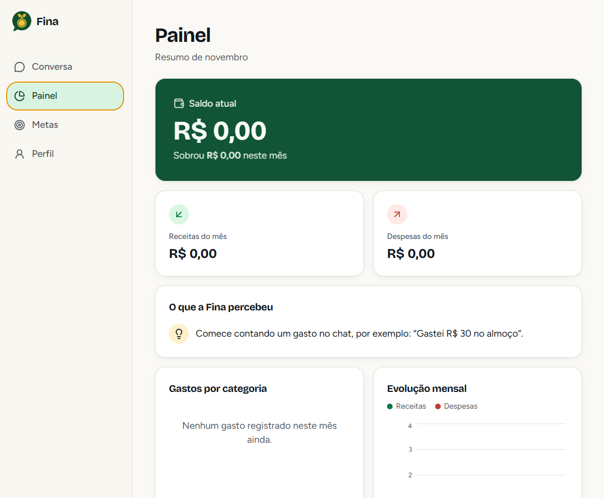
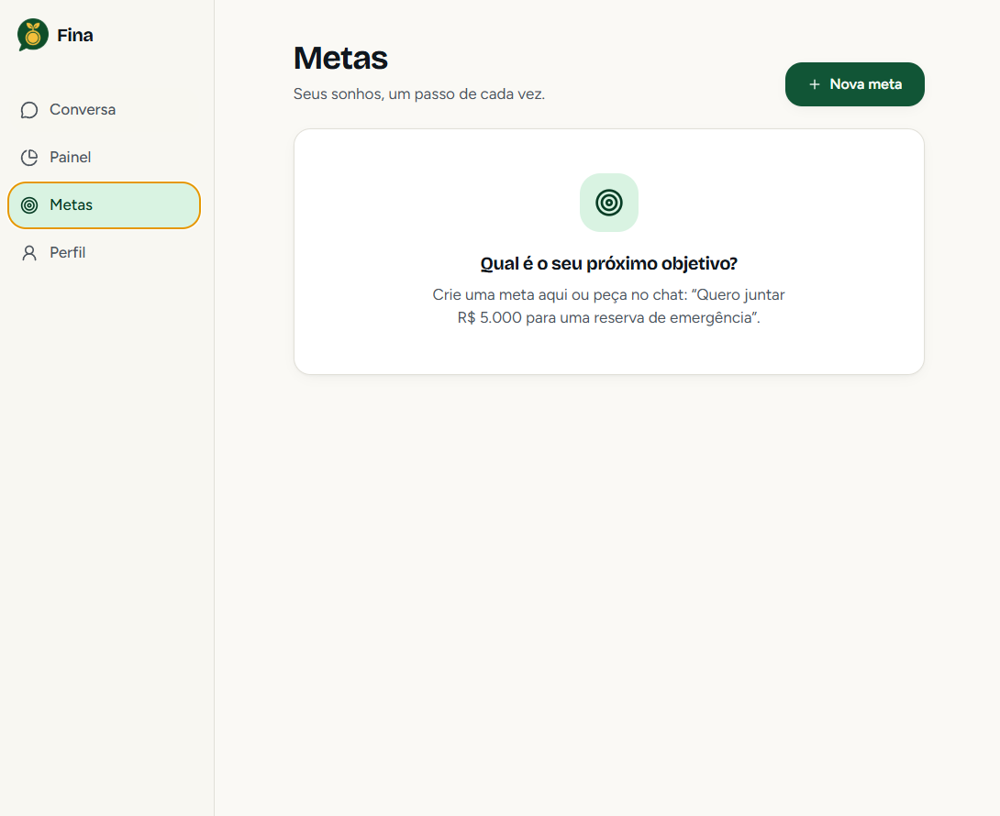
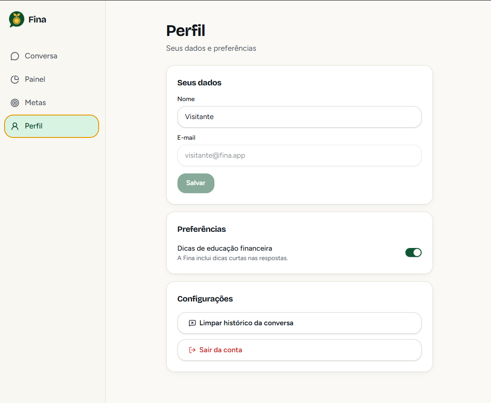

# 💰 Fina — Finanças Pessoais por Conversa

<p align="center">
  
</p>

<p align="center">
  <strong>Uma assistente financeira inteligente com IA que entende linguagem natural para registrar gastos, ganhos e metas sem planilhas e sem complicação.</strong>
</p>

<p align="center">
  
  
  
  
  
</p>

---

## 📸 Demonstração e Telas do App

<div align="center">

| Conversa Inteligente (Chat da Fina) | Painel Financeiro e Gráficos |
| :---: | :---: |
|  |  |

| Gestão de Metas | Perfil e Preferências |
| :---: | :---: |
|  |  |

</div>

---

## ✨ Funcionalidades Principais

- 🤖 **Assistente com IA em Linguagem Natural:** Entende frases cotidianas como *"Gastei R$ 50 no almoço"* ou *"Recebi R$ 2.500 de salário"* e categoriza automaticamente valor, tipo, data e categoria.
- 📊 **Painel Financeiro em Tempo Real:**
  - Saldo acumulado, receitas e despesas mensais.
  - Gráfico de pizza por categoria (Alimentação, Transporte, Moradia, etc.).
  - Evolução mensal dos últimos 6 meses com gráfico de barras.
  - Alertas automáticos inteligentes (ex.: *"Seus gastos com Lazer subiram 20% neste mês"*).
- 🎯 **Gestão de Metas:**
  - Criação de objetivos financeiros (Viagem, Reserva de Emergência, etc.).
  - Barras de progresso com cálculo percentual em tempo real.
  - Adicionar e retirar valores guardados com 1 clique.
- 👤 **Perfil e Preferências:**
  - Edição de nome, ativação/desativação de dicas educativas de finanças e limpeza de histórico.
- 📱 **Mobile-First & UI Fluida:**
  - Desenvolvido pensado em usabilidade móvel com TanStack Router, Tailwind CSS e componentes Radix UI.
- 🔒 **Autenticação:**
  - Login seguro via Supabase Auth (E-mail/Senha e Google OAuth), além de modo visitante para testes locais rápidos.

---

## 🛠️ Tecnologias Utilizadas

- **Framework Full-Stack:** [TanStack Start](https://tanstack.com/start) + [Vite](https://vitejs.dev/)
- **Linguagem:** [TypeScript](https://www.typescriptlang.org/)
- **Interface e Estilização:** [React 19](https://react.dev/), [Tailwind CSS v4](https://tailwindcss.com/), [Radix UI](https://www.radix-ui.com/), [Lucide React](https://lucide.dev/)
- **Gráficos:** [Recharts](https://recharts.org/)
- **Gerenciamento de Estado de Servidor:** [TanStack Query (React Query)](https://tanstack.com/query)
- **Backend & Banco de Dados:** [Supabase](https://supabase.com/) (PostgreSQL, Row Level Security, Auth)
- **Agente de IA:** Modelos LLM via gateway integrado com Function Calling inteligente para registro de transações e resumos.
- **Testes Automatizados:** [Vitest](https://vitest.dev/)

---

## 🚀 Como Executar o Projeto Localmente

### Pré-requisitos
- [Node.js](https://nodejs.org/) (versão 20 ou superior recomendada)
- `npm` ou `bun`

### Passo a Passo

1. **Clone o repositório:**
   ```bash
   git clone https://github.com/seu-usuario/fina-app.git
   cd fina-app
   ```

2. **Instale as dependências:**
   ```bash
   npm install --ignore-scripts
   ```

3. **Configure as variáveis de ambiente:**
   Crie um arquivo `.env` na raiz com as chaves do seu Supabase (ou use as configurações locais):
   ```env
   VITE_SUPABASE_URL="https://sua-url.supabase.co"
   VITE_SUPABASE_PUBLISHABLE_KEY="sua-chave-publica"
   ```

4. **Inicie o servidor de desenvolvimento:**
   ```bash
   npm run dev
   ```

5. **Abra no navegador:**
   Acesse [http://localhost:8080](http://localhost:8080)

---

## 🧪 Testes

Para rodar a suíte de testes unitários do vitest:

```bash
npm run test
```

Para verificar tipos do TypeScript:

```bash
npx tsc --noEmit
```

---

## 📄 Licença

Este projeto está sob a licença [MIT](LICENSE).
